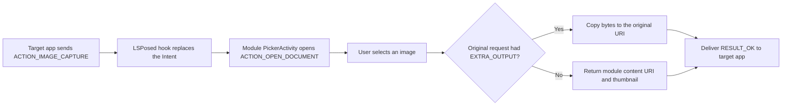

# Camera Picker for LSPosed

[简体中文](README.zh-CN.md)

[](LICENSE)


Camera Picker is a learning-oriented LSPosed/Xposed module that replaces
Android image-capture Intents with a system gallery picker. A selected image is
returned to the calling application using the same result contract normally
used by a camera application.

The native `ACTION_IMAGE_CAPTURE` plus `MediaStore.EXTRA_OUTPUT` path has been
verified on a physical Android device with LSPosed. The bundled Camera Intent
Probe makes that verification reproducible without relying on browser-specific
HTML file input behavior.

## Features

- Intercepts `MediaStore.ACTION_IMAGE_CAPTURE`.
- Intercepts `MediaStore.ACTION_IMAGE_CAPTURE_SECURE`.
- Unwraps an `ACTION_CHOOSER` containing either capture Intent.
- Preserves an existing `MediaStore.EXTRA_OUTPUT` URI and copies the selected
  image bytes into it.
- Returns a temporary read-only `content://` URI and thumbnail when the caller
  did not supply `EXTRA_OUTPUT`.
- Uses the Android document picker; the module does not request broad media or
  network permissions.
- Includes a native probe application and a separate browser compatibility
  page.

## How it works



The hook runs inside each package selected in the LSPosed module scope. It does
not modify System Framework for the normal per-app flow.

## Install

1. Download the module APK and Camera Intent Probe APK from the latest GitHub
   release.
2. Install both APKs on a rooted Android device with LSPosed.
3. Enable Camera Picker only for the browser or application you want to test.
4. Force-stop and restart that target application.
5. Trigger a native image capture request and select an image in the document
   picker.

Do not enable System Framework for the first test.

## Deterministic verification

HTML `capture` is only a browser hint. Chrome may offer a gallery even when the
module is disabled, so a web page cannot prove that an Android capture Intent
was intercepted.

Use the independent `Camera Intent Probe` application instead:

1. Leave the module disabled for `com.lyra.camerapicker.probe` and tap
   `Send ACTION_IMAGE_CAPTURE`. The real camera should open.
2. Enable the module for that package in LSPosed, then force-stop the probe.
3. Launch it again and send the same Intent. The document picker should open.
4. Select an image. The probe should display the bytes written to its original
   `EXTRA_OUTPUT` URI.

Look for this line in the LSPosed log:

```text
[CameraPicker] replaced android.media.action.IMAGE_CAPTURE for com.lyra.camerapicker.probe with EXTRA_OUTPUT
```

The static page in [`test-web`](test-web/) remains useful for comparing browser
file input behavior, image metadata, and SHA-256 values. It is not a native
Intent assertion tool.

## Supported boundary

| Capture path | Status |
| --- | --- |
| `ACTION_IMAGE_CAPTURE` | Supported |
| `ACTION_IMAGE_CAPTURE_SECURE` | Supported |
| Capture Intent inside `ACTION_CHOOSER` | Supported |
| `EXTRA_OUTPUT` URI result | Supported and physically verified |
| Legacy thumbnail/data result | Implemented |
| Camera1/Camera2/CameraX live preview | Not supported |
| Custom vendor camera SDKs | Not supported |
| Video capture | Not supported |

Applications that render their own preview through Camera1, Camera2, CameraX,
`ImageReader`, WebRTC, or a vendor SDK do not cross this Intent boundary and
need a different hook strategy.

## Build

Requirements:

- JDK 17
- Android SDK 35
- Gradle 8.7 through the included wrapper

Linux/macOS:

```shell
./gradlew :app:lintDebug :probe:lintDebug \
  :app:assembleDebug :probe:assembleDebug
```

Windows:

```powershell
.\gradlew.bat :app:lintDebug :probe:lintDebug `
  :app:assembleDebug :probe:assembleDebug
```

Outputs:

- Module: `app/build/outputs/apk/debug/app-debug.apk`
- Native probe: `probe/build/outputs/apk/debug/probe-debug.apk`

The vendored Xposed API 82 JAR is `compileOnly` and is not packaged into the
module APK.

## Project layout

- `app/`: LSPosed module and gallery-backed result Activity.
- `probe/`: independent native `ACTION_IMAGE_CAPTURE` test application.
- `test-web/`: browser compatibility page; selected files never leave the
  browser.
- `.github/workflows/`: reproducible build and lint checks.

## Troubleshooting

- No `[CameraPicker]` log: check LSPosed scope and restart the target process.
- Hook log appears but the real camera opens: confirm the target sends a native
  capture Intent instead of using Camera2/CameraX directly.
- Picker returns but the target shows no image: inspect write access to the
  original `EXTRA_OUTPUT` URI and the target's accepted image format.
- Browser offers both camera and gallery without the module: expected browser
  behavior; use Camera Intent Probe for a deterministic test.

## Privacy and responsible use

Camera Picker has no network permission. Selected image bytes are processed on
the device and are not uploaded by the module or the test page.

Use this project only on devices and applications you own or are authorized to
test. It is not intended to bypass biometric liveness, identity verification,
or other security controls.

## Contributing and license

See [CONTRIBUTING.md](CONTRIBUTING.md), [SECURITY.md](SECURITY.md), and
[THIRD_PARTY_NOTICES.md](THIRD_PARTY_NOTICES.md).

Licensed under the [Apache License 2.0](LICENSE).
