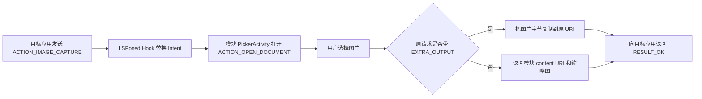

# LSPosed 相册替换相机模块

[English](README.md)

[](LICENSE)


这是一个面向学习与测试的 LSPosed/Xposed 模块。目标应用发送 Android 原生拍照
Intent 时，模块把系统相机替换为系统相册选择器，再按照相机应用常用的结果协议把
所选图片返回给目标应用。

项目已经在真实 Android + LSPosed 设备上验证了
`ACTION_IMAGE_CAPTURE + MediaStore.EXTRA_OUTPUT` 路径。仓库同时提供独立的
Camera Intent Probe，避免把浏览器自己的文件选择行为误认为模块 Hook 成功。

## 功能

- 拦截 `MediaStore.ACTION_IMAGE_CAPTURE`。
- 拦截 `MediaStore.ACTION_IMAGE_CAPTURE_SECURE`。
- 识别外层为 `ACTION_CHOOSER` 的拍照 Intent。
- 原请求带 `MediaStore.EXTRA_OUTPUT` 时，把所选图片字节写入原 URI。
- 原请求不带输出 URI 时，通过只读 `content://` URI 和缩略图返回结果。
- 使用 Android 系统文件选择器，不申请网络权限或宽泛的媒体读取权限。
- 提供原生 Probe App 和独立的网页兼容性测试页。

## 工作流程



Hook 只加载到 LSPosed 作用域中选中的目标应用进程。正常按应用测试不需要修改
System Framework。

## 安装与使用

1. 从 GitHub Releases 下载模块 APK 和 Camera Intent Probe APK。
2. 在已经 Root 并安装 LSPosed 的 Android 设备上安装两个 APK。
3. 在 LSPosed 中只给需要测试的浏览器或应用启用模块作用域。
4. 强制停止并重新启动目标应用。
5. 触发原生拍照请求，在系统文件选择器中选择图片。

第一次测试不要勾选 System Framework。

## 确定性验证

HTML `capture` 只是浏览器提示。即使没有模块，Chrome 也可能允许直接选择相册，
因此网页无法证明 Android 拍照 Intent 已被 Hook。

请使用独立的 `Camera Intent Probe`：

1. 暂时不要给 `com.lyra.camerapicker.probe` 启用模块，点击
   `Send ACTION_IMAGE_CAPTURE`，此时应打开真实相机。
2. 在 LSPosed 中只给该包启用模块，然后强制停止 Probe。
3. 再次打开 Probe 并发送同一个 Intent，此时应打开系统文件选择器。
4. 选择图片后，Probe 应显示写入原 `EXTRA_OUTPUT` URI 的图片和文件信息。

LSPosed 日志中应出现：

```text
[CameraPicker] replaced android.media.action.IMAGE_CAPTURE for com.lyra.camerapicker.probe with EXTRA_OUTPUT
```

[`test-web`](test-web/) 仍可用于观察不同浏览器的文件输入行为、图片元数据和
SHA-256，但它不是原生 Intent 断言工具。

## 支持边界

| 调用路径 | 状态 |
| --- | --- |
| `ACTION_IMAGE_CAPTURE` | 支持 |
| `ACTION_IMAGE_CAPTURE_SECURE` | 支持 |
| `ACTION_CHOOSER` 包裹的拍照 Intent | 支持 |
| `EXTRA_OUTPUT` URI 结果 | 支持，已实机验证 |
| 旧式缩略图/data 结果 | 已实现 |
| Camera1/Camera2/CameraX 实时预览 | 不支持 |
| 厂商自定义相机 SDK | 不支持 |
| 视频拍摄 | 不支持 |

直接通过 Camera1、Camera2、CameraX、`ImageReader`、WebRTC 或厂商 SDK 渲染
预览的应用不会经过此 Intent 边界，需要另一套 Hook 方案。

## 构建

环境要求：

- JDK 17
- Android SDK 35
- 使用仓库自带 Wrapper 的 Gradle 8.7

Linux/macOS：

```shell
./gradlew :app:lintDebug :probe:lintDebug \
  :app:assembleDebug :probe:assembleDebug
```

Windows：

```powershell
.\gradlew.bat :app:lintDebug :probe:lintDebug `
  :app:assembleDebug :probe:assembleDebug
```

输出文件：

- 模块：`app/build/outputs/apk/debug/app-debug.apk`
- 原生 Probe：`probe/build/outputs/apk/debug/probe-debug.apk`

仓库中的 Xposed API 82 JAR 只参与编译，不会打包进模块 APK。

## 项目结构

- `app/`：LSPosed 模块和相册结果 Activity。
- `probe/`：独立的原生 `ACTION_IMAGE_CAPTURE` 测试应用。
- `test-web/`：浏览器兼容性页面，所选文件不会上传。
- `.github/workflows/`：自动构建和 Lint 检查。

## 排查

- 没有 `[CameraPicker]` 日志：检查 LSPosed 作用域并重启目标进程。
- 有 Hook 日志但仍打开相机：确认应用发送的是原生拍照 Intent，而不是直接使用
  Camera2/CameraX。
- 选择器正常返回但目标应用不显示图片：检查原 `EXTRA_OUTPUT` URI 的写入授权和
  目标应用接受的图片格式。
- 没有模块时网页仍可选择相册：这是浏览器的正常行为，请使用 Probe 确定验证。

## 隐私与合理使用

模块不申请网络权限。图片字节只在设备本地处理，模块和网页测试页都不会上传文件。

请只在自己拥有或获授权测试的设备和应用上使用。项目不用于绕过活体检测、身份验证
或其他安全控制。

## 贡献与许可证

参见 [CONTRIBUTING.md](CONTRIBUTING.md)、[SECURITY.md](SECURITY.md) 和
[THIRD_PARTY_NOTICES.md](THIRD_PARTY_NOTICES.md)。

项目使用 [Apache License 2.0](LICENSE) 开源。
